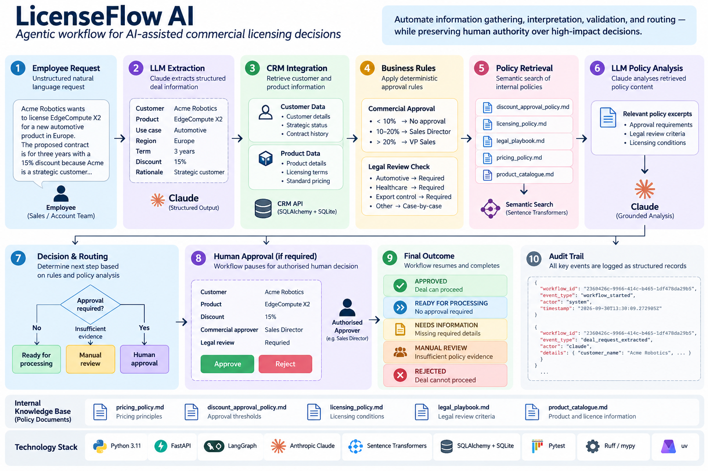

# LicenseFlow AI

**A production-style agentic workflow for AI-assisted commercial licensing decisions.**

LicenseFlow explores how agentic AI can automate multi-step enterprise workflows spanning unstructured requests, CRM data, internal policies, deterministic business rules, and human approvals — without giving the model unrestricted authority over high-impact decisions.

---

## Why LicenseFlow?

Many enterprise workflows still depend on manual handoffs between people, emails, documents, and internal systems.

A typical commercial licensing request may require someone to:

1. understand an unstructured request,
2. retrieve customer and product information from a CRM,
3. check internal pricing and licensing policies,
4. determine the appropriate approval path,
5. involve Legal where necessary,
6. request missing information,
7. route the deal to the correct human decision-maker, and
8. preserve an audit trail of how the decision was reached.

LLMs can help automate parts of this process, but allowing an AI system to make unrestricted commercial or legal decisions introduces unnecessary risk.

LicenseFlow therefore follows a simple design principle:

> **Automate information gathering, interpretation, validation, and routing — while preserving human authority over high-impact decisions.**

---

## Example

A user submits:

> Acme Robotics wants to license EdgeCompute X2 for a new automotive product in Europe. The proposed contract is for three years with a 15% discount because Acme is a strategic customer making a multi-year commitment.

LicenseFlow processes the request and determines:

```text
Customer
Acme Robotics

Product
EdgeCompute X2

Use case
Automotive

Region
Europe

Contract term
3 years

Discount
15%

Commercial approval
Sales Director required

Legal review
Required

Workflow status
AWAITING HUMAN APPROVAL
```

The workflow then pauses until an authorised human approves or rejects the request.

---

## Architecture



---

## Core Workflow

LicenseFlow is implemented as a stateful LangGraph workflow.

```text
START
  ↓
Extract Request
  ↓
Check Required Information
  ├── Missing → NEEDS_INFORMATION → END
  ↓
Retrieve CRM Data
  ↓
Build Deal
  ↓
Apply Commercial Rules
  ↓
Retrieve Internal Policies
  ↓
Analyse Retrieved Policy
  ├── Insufficient evidence → MANUAL_REVIEW → END
  ↓
Approval Required?
  ├── No → READY_FOR_PROCESSING → END
  ↓
Human Approval
  ├── Approve → APPROVED → END
  └── Reject  → REJECTED → END
```

The graph is checkpointed so that execution can pause for human review and later resume from the same workflow state.

---

## Design Principles

### 1. Use LLMs where language understanding is required

Claude is used for tasks such as:

- extracting structured deal information from natural-language requests;
- interpreting retrieved internal policy text.

It is not used for deterministic rules that are better represented directly in code.

For example:

```text
Discount < 10%
→ No additional commercial approval

Discount 10–20%
→ Sales Director approval

Discount > 20%
→ VP Sales approval
```

These thresholds are enforced deterministically.

---

### 2. Do not invent missing information

If a request does not contain enough information, the workflow stops.

For example:

```text
Acme Robotics wants EdgeCompute X2 with a 15% discount.
```

may produce:

```text
Missing:
- use_case
- region
- contract_term_years
- commercial_rationale

Status:
NEEDS_INFORMATION
```

The LLM is explicitly instructed not to infer unspecified values.

---

### 3. Ground policy reasoning in retrieved documents

Claude does not rely on its general knowledge to determine internal company policy.

Instead:

```text
Deal context
    +
Semantic retrieval
    ↓
Relevant internal policy excerpts
    ↓
Claude policy analysis
```

Only retrieved policy content is supplied to the policy-analysis step.

If the available policy evidence is insufficient, the workflow returns:

```text
MANUAL_REVIEW
```

rather than forcing a decision.

---

### 4. Keep humans in control

Commercial and legal decisions remain under human authority.

When approval is required, LangGraph interrupts execution and exposes the decision context to a human reviewer.

Example:

```text
Customer: Acme Robotics
Product: EdgeCompute X2
Discount: 15%

Commercial approver:
Sales Director

Legal review:
Required

[Approve] [Reject]
```

The workflow resumes only after receiving a human decision.

Anything other than an explicit approval is handled conservatively.

---

### 5. Separate enterprise systems from the AI layer

LicenseFlow does not allow the workflow to access the CRM database directly.

Instead:

```text
LicenseFlow
    ↓ HTTP
Fake CRM API
    ↓
SQLAlchemy
    ↓
SQLite
```

This simulates how an AI application would integrate with an existing enterprise system through an API boundary.

---

## Internal Knowledge Base

The project uses a fictional internal policy set designed to simulate commercial licensing operations.

```text
knowledge_base/
├── pricing_policy.md
├── discount_approval_policy.md
├── licensing_policy.md
├── legal_playbook.md
└── product_catalogue.md
```

These documents define areas such as:

- pricing principles;
- discount approval thresholds;
- standard licensing conditions;
- circumstances requiring Legal review;
- product and licence information.

They are fictional and exist solely for demonstration purposes.

---

## Retrieval

LicenseFlow uses Sentence Transformers to embed policy chunks and perform semantic retrieval.

This allows questions such as:

```text
Do we need lawyers involved if the technology will be used in a car?
```

to retrieve policy language referring to:

```text
automotive applications
legal review
```

even where the wording is not identical.

For the current small knowledge base, embeddings are searched directly without introducing a dedicated vector database.

This is intentional: the architecture remains as simple as possible for the current data volume.

A larger deployment could replace this layer with technologies such as `pgvector` or a managed search service.

---

## Audit Trail

Each workflow receives a unique `workflow_id`.

Significant events are recorded as structured JSONL records:

```text
workflow_started
deal_request_extracted
crm_data_retrieved
policy_retrieved
human_decision
```

Example:

```json
{
  "workflow_id": "2360426c-9966-414c-b465-1df478da29b5",
  "event_type": "human_decision",
  "actor": "human",
  "details": {
    "decision": "approve",
    "comment": "Approved after review."
  }
}
```

This makes it possible to trace:

```text
Original request
       ↓
LLM extraction
       ↓
CRM records used
       ↓
Policies retrieved
       ↓
AI interpretation
       ↓
Human decision
```

Sensitive CRM records are not copied wholesale into the audit log; only identifiers required for traceability are recorded.

---

## Evaluation & Testing

The project includes automated tests for both business behaviour and technical components.

Representative workflow scenarios include:

| Scenario | Expected behaviour |
|---|---|
| Standard deal with 5% discount | Ready for processing |
| 15% automotive deal | Sales Director + Legal review + human approval |
| 25% discount | VP Sales approval |
| Missing contract information | Needs information |
| Insufficient policy evidence | Manual review |

Additional tests cover:

- commercial approval rules;
- FastAPI health checks;
- CRM API behaviour;
- unknown-customer handling;
- policy document loading;
- semantic policy retrieval;
- human-in-the-loop approval paths.

### Current coverage

```text
Overall test coverage:          87%
Core LangGraph workflow:        97%
Semantic retriever:            100%
Document loader:               100%
Commercial approval rules:     100%
Database models:               100%
```

The tests mock external LLM and CRM dependencies where appropriate so that core workflow behaviour remains deterministic and reproducible.

---

## Technology Stack

### AI / Agentic Workflow

- Anthropic Claude
- LangGraph
- Sentence Transformers
- Structured LLM outputs with Pydantic
- Semantic retrieval
- Human-in-the-loop workflow execution

### Backend

- Python 3.11
- FastAPI
- Pydantic
- SQLAlchemy
- HTTPX

### Data

- SQLite for the local CRM simulation
- Markdown policy knowledge base
- JSONL audit logging

### Engineering

- `uv` dependency management
- Pytest
- pytest-cov
- Ruff
- mypy

---

## Project Structure

```text
licenseflow-ai/
│
├── knowledge_base/
│   ├── discount_approval_policy.md
│   ├── legal_playbook.md
│   ├── licensing_policy.md
│   ├── pricing_policy.md
│   └── product_catalogue.md
│
├── src/
│   └── licenseflow_ai/
│       ├── api/
│       │   ├── routes/
│       │   └── main.py
│       │
│       ├── database/
│       │   ├── base.py
│       │   └── models.py
│       │
│       ├── llm/
│       │   ├── deal_extractor.py
│       │   └── policy_analyzer.py
│       │
│       ├── models/
│       │   ├── approval.py
│       │   ├── audit.py
│       │   ├── customer.py
│       │   ├── deal.py
│       │   ├── deal_request.py
│       │   ├── product.py
│       │   └── workflow_result.py
│       │
│       ├── rag/
│       │   ├── document_loader.py
│       │   └── semantic_retriever.py
│       │
│       ├── services/
│       │   ├── approval_rules.py
│       │   ├── audit_logger.py
│       │   └── crm_client.py
│       │
│       └── workflows/
│           └── deal_graph.py
│
├── tests/
│   ├── test_api.py
│   ├── test_approval_rules.py
│   ├── test_deal_graph.py
│   └── test_rag.py
│
├── .env.example
├── .gitignore
├── pyproject.toml
└── README.md
```

---

## Running Locally

### 1. Clone the repository

```bash
git clone <repository-url>
cd licenseflow-ai
```

### 2. Install dependencies

```bash
uv sync
```

### 3. Configure environment variables

Create `.env` from the example:

```bash
cp .env.example .env
```

Configure:

```text
ANTHROPIC_API_KEY=your_api_key
ANTHROPIC_WORKSPACE_ID=your_workspace_id_if_required
LICENSEFLOW_LLM_MODEL=your_claude_model
```

Never commit `.env` or API credentials.

---

### 4. Start the CRM API

```bash
uv run uvicorn licenseflow_ai.api.main:app --reload
```

API documentation is available locally at:

```text
http://127.0.0.1:8000/docs
```

Health check:

```text
GET /health
```

---

### 5. Run the tests

```bash
uv run pytest -v
```

Coverage:

```bash
uv run pytest \
  --cov=licenseflow_ai \
  --cov-report=term-missing
```

---

## Example Workflow

```python
from langgraph.types import Command

from licenseflow_ai.workflows.deal_graph import deal_graph


config = {
    "configurable": {
        "thread_id": "demo-deal-001"
    }
}


output = deal_graph.invoke(
    {
        "text": (
            "Acme Robotics wants to license EdgeCompute X2 "
            "for a new automotive product in Europe. "
            "The proposed contract is for three years "
            "with a 15% discount because Acme is a "
            "strategic customer making a multi-year commitment."
        )
    },
    config=config,
)
```

If approval is required, execution pauses.

It can then be resumed with a human decision:

```python
result = deal_graph.invoke(
    Command(
        resume={
            "decision": "approve",
            "comment": "Approved after commercial review.",
        }
    ),
    config=config,
)
```

---

## Production Considerations

LicenseFlow is a portfolio implementation designed to demonstrate production-oriented architecture rather than a production-deployed commercial system.

The local implementation currently uses:

- SQLite for CRM persistence;
- in-memory LangGraph checkpointing;
- local JSONL audit logs;
- local semantic retrieval.

A production deployment would replace these where appropriate with durable infrastructure such as:

```text
Managed relational database
Durable LangGraph checkpoint store
Centralised structured logging
Secret management
Authentication / authorisation
Persistent audit storage
Rate limiting
Retry / timeout policies
Monitoring and tracing
```

The architecture deliberately separates these concerns so individual components can be replaced without redesigning the core workflow.

---

## Key Engineering Decisions

### Why not let the LLM decide discount approvals?

Because explicit approval thresholds are deterministic business rules.

Encoding them directly in code is more reliable, testable, auditable, and predictable than asking an LLM to reproduce them.

### Why use an LLM for policy interpretation?

Internal policies are primarily written in natural language and may involve wording that is difficult to reduce to a small number of deterministic conditions.

The LLM therefore interprets only policy excerpts retrieved from the internal knowledge base.

### Why stop when information is missing?

A workflow that confidently invents missing business information is more dangerous than one that asks for clarification.

`NEEDS_INFORMATION` is therefore a first-class workflow state.

### Why include human approval?

The objective is not maximum automation.

The objective is **safe automation of repetitive work while retaining human accountability for consequential commercial and legal decisions.**

---

## What This Project Demonstrates

LicenseFlow focuses on a different engineering problem from traditional predictive ML systems.

It demonstrates how to move from:

```text
Useful LLM prototype
```

to:

```text
Structured enterprise AI workflow
```

with:

- API integrations;
- relational data;
- structured LLM outputs;
- semantic retrieval;
- grounded reasoning;
- deterministic business rules;
- explicit workflow state;
- human-in-the-loop controls;
- auditability;
- reproducible automated testing.

The broader question behind the project is:

> **How can AI be made genuinely useful in production enterprise workflows without sacrificing reliability, traceability, or human control?**